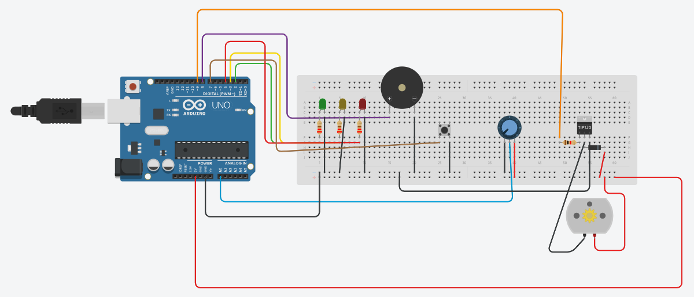

# IoT Smart Water Tank Overflow Alert

A low-cost IoT mini project that monitors a water tank level, warns before it overflows and automatically stops the pump. It is simulated in **Tinkercad Circuits** with an Arduino UNO; the real build swaps in an ESP8266/ESP32 so the level can be sent to a phone or web dashboard.



## How it works

| Level | LED | Status | Pump | Buzzer |
|-------|-----|--------|------|--------|
| 0–39 % | Green | LOW | ON | off |
| 40–79 % | Yellow | MEDIUM | ON | off |
| 80–89 % | Red | FULL | ON | **alert** |
| 90–100 % | Red | FULL | OFF | **alert** |

A push button toggles a manual pump override. The Serial Monitor prints, for example:

```
Water Level: 82% | FULL | Pump: ON
```

## Components (Tinkercad)

- Arduino UNO R3
- 3 × LED (green, yellow, red) with 3 × 220 Ω resistors
- Potentiometer (simulates the water-level sensor)
- Piezo buzzer
- Push button
- DC motor (pump), TIP120 transistor, 1 kΩ resistor, diode
- Breadboard and jumper wires

## Wiring

| Arduino pin | Connects to |
|-------------|-------------|
| D2 | 220 Ω → green LED anode (cathode to GND) |
| D3 | 220 Ω → yellow LED anode (cathode to GND) |
| D4 | 220 Ω → red LED anode (cathode to GND) |
| D7 | Push button (other side to GND, internal pull-up) |
| D8 | Buzzer + (other leg to GND) |
| D9 | 1 kΩ → TIP120 base |
| A0 | Potentiometer middle leg (outer legs to 5V and GND) |
| 5V / GND | Breadboard + / − rails |

Pump driver: TIP120 emitter to GND, collector to the motor's negative lead, motor's positive lead to 5V. The diode sits across the motor with the **striped end (cathode) toward 5V**; it absorbs the voltage spike when the motor switches off.

## Run it

1. Open the circuit in Tinkercad Circuits and paste `smart_tank_overflow_alert.ino` into the Code panel (Text mode).
2. Click **Start Simulation** and open the Serial Monitor.
3. Turn the potentiometer to change the water level and watch the LEDs, buzzer and pump respond.

## Real hardware version

| Simulation | Real build |
|------------|------------|
| Arduino UNO | ESP8266 NodeMCU / ESP32 |
| Potentiometer | Water-level sensor |
| Serial Monitor | Phone / web dashboard (Blynk, ThingSpeak) |
| DC motor via TIP120 | Mini pump via relay module |

## Files

- `smart_tank_overflow_alert.ino` – Arduino sketch
- `circuit.png` – Tinkercad circuit screenshot
